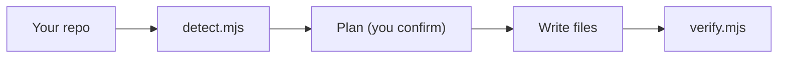
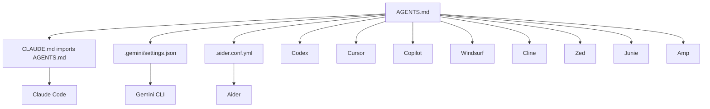
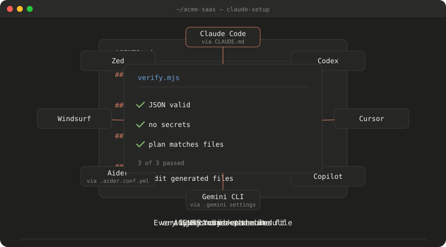

<p align="center">
  
</p>

<p align="center">
  <a href="https://www.npmjs.com/package/@claude-setup-skill/install"></a>
  <a href="https://www.npmjs.com/package/@claude-setup-skill/install"></a>
  <a href="LICENSE"></a>
  <a href="https://github.com/sir-ad/claude-setup-skill/stargazers"></a>
  <a href="https://github.com/sir-ad/claude-setup-skill/commits/main"></a>
  
  <a href="https://code.claude.com"></a>
</p>

**Coding agents guess your build and test commands. This gives every agent the real ones.**

claude-setup detects your stack and writes one [`AGENTS.md`](https://agents.md) that your agents read. It lists commands traced to your package scripts, Makefile and CI, hard rules quoted with their source, and version notes. It also writes a repo map, topic rules and a small agent pipeline.

It runs inside [Claude Code](https://code.claude.com) and needs Node 18 or newer on your PATH. The files it writes work with other agents too.

## Quick start

1. Install the skill: `npx -y @claude-setup-skill/install`
2. Go to a project folder and run `claude`.
3. Type `/claude-setup`.

To see the plan first, add `--dry-run`. Nothing is written.

## Before / after

Before, a typical hand-written file:

```markdown
# Project notes

- Write clean, readable code.
- Run the tests before you commit.
- Keep functions small.
- Follow the best practices for the framework.
```

After, part of the `AGENTS.md` from [`examples/acme-saas.md`](./examples/acme-saas.md). The project is fictional.

```markdown
# acme-saas

## Commands
- Install: `pnpm install --frozen-lockfile`
- Test: `pnpm test`
- Typecheck: `pnpm run typecheck`

## Hard rules
- "PII never in logs." (README.md:41)

## Version notes
- Next.js 15: `cookies()`, `headers()`, `params` and `searchParams` are async. Await them.
- Turborepo 2: tasks go under `tasks` in `turbo.json`. The old `pipeline` key is gone.
```

## How it works



1. **Detect.** `context.mjs` runs the detector and the repo graph. The detector reads manifests, CI workflows and existing agent files. It never reads `.env` files or lockfile contents. Commands marked `implied:` are inferred from a manifest, so the skill checks them against your scripts.
2. **Load guidance.** The matching template, knowledge notes (only the bullets for your detected versions), the repo graph and the agent roster load into context. Blueprints load on demand.
3. **Plan.** The skill prints every file it will write, with the exact `settings.json`. It asks you to confirm.
4. **Write.** It writes `.claude/` first, then `docs/`, the adapters, and `AGENTS.md` and `CLAUDE.md` last, so they only link to files that exist.
5. **Verify.** `verify.mjs` checks line counts, JSON, secret-like text and the `@AGENTS.md` import. The skill then compares the files with the plan.

## What your agents get

```
AGENTS.md                      commands, working agreements, hard rules, version notes. Every agent reads it
CLAUDE.md                      imports AGENTS.md, adds Claude-only token habits
docs/
  architecture.md              components and data flow, from what the code shows
  project-structure.md         module graph, entry points, central modules. --update refreshes it
  config.md                    env var names and config files, never values
  agents.md                    the role roster, routing table and delegation contract. --update refreshes it
  decisions/                   ADR template, only if you have no ADR folder
.claude/
  settings.json                narrow allow rules, deny rules for secrets and destructive commands
  router.json                  routes and tiers for the router hook
  hooks/route.mjs              the router, a copy that runs without the skill installed
  rules/
    code-style.md              only what your linter does not already enforce
    testing.md                 runner, single-test command, fixtures
    security.md                short always-on checklist
  agents/
    explorer.md                read-only search that returns file:line
    test-runner.md             runs your checks, returns only failures
    <lang>-reviewer.md         read-only review, keeps project memory
    <role>.md                  one scoped worker per role the repo shows evidence for (frontend, backend, data, ...)
  skills/
    plan-task/                 explore, write a plan file, stop for approval
    orchestrate/               route a goal, dispatch role agents, test, review, report
    handoff/                   save session state so a new session can continue
.codex/agents/  .gemini/agents/  .opencode/agents/
                               the same agents for the tools you select, generated from .claude/agents/
```

Each file comes from your repo, a script or a cited note. A file is skipped when an equivalent exists.

## Agentic pipeline

The default is one main agent plus narrow helpers. The flow is explore, plan, implement, verify.

1. `explorer` searches without filling your main context.
2. `/plan-task <task>` writes `docs/plans/<date>-<slug>.md` and stops. You approve.
3. The main agent implements it step by step, or hands scoped work to a role agent. `test-runner` returns only failing checks. After 3 failed fixes, the agent stops and reports.
4. `/handoff` writes `.claude/handoff.md`. An optional hook prints it when a session starts.

`/orchestrate <goal>` runs the whole sequence. Subagents cannot start other subagents. Anthropic notes that coding has fewer parallel subtasks than research, so more agents help less. Google's ADK gives the same advice to give each agent one job. The pattern mapping and sources are in [`reference/agentic-pipeline.md`](./reference/agentic-pipeline.md).

## Agent roster and routing

Roles come from evidence in your repo, not from a template. `scripts/roster.mjs` reads the detector and the repo graph. A `frontend` role needs a UI framework or UI directories. A `data` role needs an ORM or migrations. At most 8 roles are written besides `explorer`. The Why column shows the evidence. Excerpt for a pnpm monorepo (create-t3-app):

| Role | Tier | Scope | Why |
|---|---|---|---|
| frontend | standard (sonnet) | `cli/template/base/**`, `www/**` | 38 files import next; react@19 |
| backend | standard (sonnet) | `cli/template/extras/src/**` | 15 files import @trpc/server |
| data | standard (sonnet) | `cli/template/extras/config/**`, `cli/template/extras/src/**` | 16 files import drizzle-orm |
| security-reviewer | deep (opus) | `cli/template/extras/src/**` | auth libraries in use |

Tiers set the model. `fast` is haiku (search, test runs, docs), `standard` is sonnet (work inside one scope), `deep` is opus (review, security). Other tools inherit the session model unless you pass `--model-map fast=X,standard=Y,deep=Z` with names you choose. See [`reference/model-tiers.md`](./reference/model-tiers.md).

The router is a `UserPromptSubmit` hook. It scores each prompt against the roster with plain rules and adds one line:

```text
Route: frontend agent (tier standard/sonnet), effort medium, plan no, then test-runner. Confidence 0.88. Override by saying 'no routing'.
```

It runs a local Node script in about 70 ms with no network. It adds context only and cannot change the model or block a prompt. Write "no routing" in a prompt, or set `CLAUDE_SETUP_ROUTER=off`, to skip it. It logs a hash and the decision to a gitignored file, never the prompt text.

Rules are the default for a reason. Small learned routers exist. Laya is a 421M model with checkpoints of about 2.3 GB and a 7 to 10 second load. Strands Decider 2B is a 4.5 GB download and took 3 to 5 seconds per call on a laptop CPU. Both are version 0.1 projects. A hook that waits seconds slows every prompt. Both are optional backends (`CLAUDE_SETUP_ROUTER=ollama` or `decider`) and are used only when the rules are unsure. Details and sources are in [`reference/routing.md`](./reference/routing.md).

Other tools have no hooks. They read the Routing and Delegation sections of `AGENTS.md`.

## Code search and embeddings

Embeddings are opt-in. The default is agentic search (grep and glob) plus the generated repo graph. An index has to be built, can drift from the code, and needs a place to live. The graph needs none of that. For large repos the plan can offer an MCP server: a local language-server or graph tool, or a semantic index that needs an embedding API key and a vector database. `.mcp.json` is written only on a yes. See [`reference/code-search.md`](./reference/code-search.md).

## One file, every agent

Most agents read `AGENTS.md` directly. Claude Code, Gemini CLI and Aider need a small file that points to it.



Copilot chat on github.com reads only `.github/copilot-instructions.md`, which the skill does not write.

## See it

<p align="center">
  
</p>

<p align="center">
  
</p>

[Try the interactive explorer](https://htmlpreview.github.io/?https://github.com/sir-ad/claude-setup-skill/blob/main/docs/index.html). You can also open `docs/index.html` in a browser.

## What it writes

| File | When |
|---|---|
| `AGENTS.md`, `CLAUDE.md`, `.claude/settings.json` | always. Allow rules cover only your commands and read-only git |
| `docs/` files | default. Skipped by `--skip-docs` or when an equivalent exists |
| `.claude/rules/` topic rules | default. Directory rules only for directories with distinct conventions |
| `.claude/agents/`, `plan-task`, `orchestrate`, `handoff`, router | default. Skipped by `--skip-pipeline`. The router also by `--no-router` |
| `.claude/skills/<n>/`, `.worktreeinclude` | per real workflow (release, preview deploy), and for gitignored files that worktrees need |
| Adapters | `.gemini/settings.json`, `.aider.conf.yml`, and rule mirrors for Cursor, Copilot, Cline and Windsurf. Only for agents you pick or already use |
| Formatter hook, handoff hook, `.mcp.json`, `.codex/config.toml` | only if you say yes in the plan |

It never writes empty folders, placeholder skills or legacy single-file rules.

## What is checked, and what is instructed

Scripts enforce these:
- The detector lists each command with its source, such as `package.json#scripts.*` or a CI workflow. Nothing runs a command unless you say yes to one optional check.
- The router unit, the graph fence in `docs/project-structure.md` and the roster fence in `docs/agents.md` come from `emit.mjs`, which writes script output only between fence markers.
- `verify.mjs` checks line counts, JSON syntax, secret-like text, the `@AGENTS.md` import, unsafe settings and the fences (no placeholders, text equal to script output). It does not print a matched secret.
- The detector skips `.env` files, and the generated settings deny reads of them.

The skill instructs the model to do these, and they are not enforced by code:
- Quote each hard rule in full with its `file:line`, and never trim a qualifier such as "unless".
- Write a version note only when your project declares that version. The notes live in `knowledge/` with their sources. The one-line notes in `AGENTS.md` do not carry links.
- Print the plan first, write exactly what it lists, and report any drift.
- Open your scripts before writing a command, and grep the repo before banning a pattern in a rule.

## Flags

| Flag | Effect |
|---|---|
| `--dry-run` | print the plan, write nothing |
| `--minimal` | only `AGENTS.md`, `CLAUDE.md` and `.claude/settings.json`. No roster, router, docs or pipeline |
| `--skip-docs` | skip the `docs/` files |
| `--skip-pipeline` | skip the helpers, role agents, router, `plan-task`, `orchestrate`, `handoff` and the working agreements |
| `--skip-skills` | skip all `.claude/skills/` |
| `--no-router` | skip the router hook and its two files. The roster stays |
| `--intent "<text>"` | shape the roster for what you plan to build. A role from the text needs a named capability and is marked as intent |
| `--model-map fast=X,standard=Y,deep=Z` | write these model names into the Codex, Gemini and opencode agent files |
| `--agents=<list>` | write adapters for these agents: `claude,codex,cursor,copilot,gemini,aider,cline,windsurf` or `all`. Default is Claude plus any agent whose config already exists |
| `--update` | re-run detection, show a diff against your current files, apply only the hunks you confirm. Your own prose is never rewritten |

To refresh a project you already set up, run `/claude-setup --update` in it.

## Stacks

| Stack | Template |
|---|---|
| Node monorepo (npm / pnpm / yarn workspaces, turbo, nx, lerna) | `templates/node-monorepo.md` |
| Node single (Next.js, Vite, Astro, Express, ...) | `templates/node-single.md` |
| Python (Poetry, uv, pip, hatch, rye) | `templates/python.md` |
| Go | `templates/go.md` |
| Rust single crate | `templates/rust-single.md` |
| Rust workspace | `templates/rust-workspace.md` |
| Java / Kotlin (Maven, Gradle) | `templates/jvm.md` |
| Ruby | `templates/ruby.md` |
| .NET | `templates/dotnet.md` |
| PHP | `templates/php.md` |
| Anything else | `templates/generic.md` |

## Agents

`AGENTS.md` is the shared source of truth. Most agents read it directly.

| Agent | What the skill does |
|---|---|
| Claude Code | `CLAUDE.md` imports `AGENTS.md`, plus `.claude/` extras |
| Codex | reads `AGENTS.md`. Agent files in `.codex/agents/`, mirrored from `.claude/agents/` |
| opencode | reads `AGENTS.md`. Agent files in `.opencode/agents/` |
| Zed, Junie, Amp, Kiro | nothing extra. They read `AGENTS.md` |
| Cursor, Copilot, Cline, Windsurf | read `AGENTS.md`. Optional mirrors of your `.claude/rules/` for path-scoped rules |
| Gemini CLI | `.gemini/settings.json` so it reads `AGENTS.md`. Agent files in `.gemini/agents/` |
| Aider | `.aider.conf.yml` so it reads `AGENTS.md` |

Hazards and details, such as legacy `.cursorrules` files that shadow `AGENTS.md` in Zed, are in [`reference/agent-adapters.md`](./reference/agent-adapters.md).

## Install options

All three put the skill in `~/.claude/skills/claude-setup/`.

```sh
npx -y @claude-setup-skill/install                             # run once
npm i -g @claude-setup-skill/install && claude-setup-install   # keep a command for reruns
```

```sh
git clone https://github.com/sir-ad/claude-setup-skill ~/claude-setup-skill   # from source
cd ~/claude-setup-skill && ./install.sh
```

The npm methods copy files. From source, a symlink points at your clone, so edits take effect at once. Run `git pull` in the clone to update.

## Uninstall

```sh
npx -y @claude-setup-skill/install --uninstall   # npm install
./install.sh --uninstall                         # from source
```

From source, this removes the symlink. It doesn't touch this repo or the files generated in your projects.

## Headless / CI

- `claude -p "/claude-setup --dry-run"` prints the plan and writes nothing.
- For a run that writes files, use interactive mode. With `--permission-mode acceptEdits`, Claude Code refuses writes under `.claude/`. The skill then stages those files under `.claude-setup/staged/` and lists them in its report.
- Run `node .claude-setup/apply.mjs` from the project root to put the staged files in place.
- If the skill cannot load its context because the skill directory is outside the allowed paths, pass `--add-dir ~/.claude/skills/claude-setup`.

## Contributing

Run `npm run check` to validate the repo files and run the tests. It needs Node 18 or newer and no dependencies. See [CONTRIBUTING.md](./CONTRIBUTING.md) for how to add a stack template or a knowledge note.

## License

MIT. See [LICENSE](./LICENSE).
