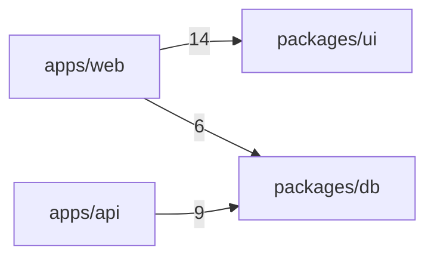

# Example: acme-saas (Node monorepo, pnpm + turbo)

This is what `/claude-setup` produced for a typical SaaS Node monorepo. The project is fictional. Use it to see how `templates/node-monorepo.md` and the `knowledge/` notes turn into actual files.

## What the detector found

From `node scripts/detect.mjs .`:

- `primary: node`, `layout: monorepo`, `packageManager: pnpm`
- `workspaces`: `apps/web`, `apps/api`, `packages/db`, `packages/ui`
- `frameworks`: `next 15`, `react 19`, `tailwindcss 4`, `turbo 2`, `hono`, `drizzle-orm`, `vitest`, `prettier`
- `commands`: install, build, test, lint, typecheck and dev, each with its source (`package.json#scripts.*` or `.github/workflows/ci.yml`)
- `agentConfigs`: `.cursor/rules/` exists, so Cursor is selected next to Claude
- `versionFiles`: `package.json`, with `CHANGELOG.md` and `.changeset/` present, so a `/release` skill is justified
- `docs`: `docs/adr/` exists, so `docs/decisions/` is skipped
- `infra`: `vercel: true`, so a `/preview-deploy` skill is justified
- `hardRuleCandidates` from `README.md`: "PII never in logs", "Drizzle migrations are append-only", "App Router only", and two more that the skill dropped as marketing text

## Files written

```
acme-saas/
├── AGENTS.md                          # source of truth, read by every agent
├── CLAUDE.md                          # @AGENTS.md + token habits for Claude Code
├── .worktreeinclude                   # .env, .env.local, CLAUDE.local.md
├── docs/
│   ├── agents.md                      # roster + routing tables (script output) and delegation contract
│   ├── architecture.md                # components and data flow, from the code
│   ├── project-structure.md           # module graph (script output) + short notes
│   └── config.md                      # env var names from .env.example, never values
├── .cursor/rules/                     # mirrors of .claude/rules, via sync-rules.mjs
│   ├── web-next.mdc
│   ├── api-hono.mdc
│   └── db-drizzle.mdc
└── .claude/
    ├── settings.json                  # pnpm/turbo/read-only git allows; force-push, hard reset, `pnpm publish`, `changeset publish` and .env denies. `pnpm run release` stays allowed: it only runs `changeset version`
    ├── rules/
    │   ├── code-style.md              # only what ESLint and Prettier do not enforce
    │   ├── testing.md                 # Vitest, single-test command, no live DB in unit tests
    │   ├── security.md                # always on: secrets, input validation, PII in logs
    │   ├── web-next.md                # apps/web/**: App Router, RSC vs client, server actions
    │   ├── api-hono.md                # apps/api/**: Hono handlers, env via wrangler
    │   └── db-drizzle.md              # packages/db/**: schema + append-only migrations
    ├── agents/
    │   ├── explorer.md                # read-only search, returns path:line
    │   ├── test-runner.md             # runs test/lint/typecheck, returns only failures
    │   ├── ts-reviewer.md             # TS strict, RSC, PII checks; memory: project; model: opus
    │   ├── frontend.md                # edits apps/web/**, sonnet
    │   ├── backend.md                 # edits apps/api/**, sonnet
    │   └── data.md                    # edits packages/db/**, sonnet
    ├── hooks/route.mjs                # router, written by emit.mjs as a copy of the skill's route.mjs
    ├── router.json                    # routes and tiers from the roster
    └── skills/
        ├── plan-task/SKILL.md         # /plan-task: explore, write docs/plans/..., stop
        ├── orchestrate/SKILL.md       # /orchestrate: route, dispatch role agents, test, review
        ├── handoff/SKILL.md           # /handoff: write .claude/handoff.md
        ├── release/SKILL.md           # changeset version, build, test, tag
        └── preview-deploy/SKILL.md    # vercel deploy + smoke check
```

`docs/decisions/` was not written: the repo already has `docs/adr/`. `.gitignore` got `CLAUDE.local.md`, `.claude/settings.local.json`, `.claude/worktrees/` and `.claude/handoff.md` and `.claude/route-log.jsonl` appended. No formatter hook and no handoff hook: the user answered no in the plan step. No `.mcp.json`: embeddings and code-search servers are opt-in.

## docs/project-structure.md (excerpt)

The block between the markers is script output from `scripts/graph.mjs`, written by `emit.mjs` and never typed by hand. The numbers are import counts. The notes below it are written by the model from files it opened.

````markdown
# Project structure

pnpm workspaces. Two apps and two packages. Apps import from packages, never the reverse.

<!-- claude-setup:begin graph -->
### Module graph



### Entry points

- `apps/api/src/index.ts` (package-main, apps/api/package.json "main")

### Central modules

- `packages/db`: imported by 2 modules, 11 files
- `packages/ui`: imported by 1 module, 8 files
<!-- claude-setup:end graph -->

## Notes
- `packages/db/` - Drizzle schema and migrations. Migrations are append-only.
- `apps/api/` - Hono on Cloudflare Workers. No Node-only dependencies.

## Generated, do not edit
- `packages/db/migrations/meta/` - regenerate with `pnpm -C packages/db run generate`
````

`/claude-setup --update` replaces only the text between the markers. The notes stay as written.

## AGENTS.md (excerpt)

```markdown
# acme-saas

TypeScript monorepo. pnpm workspaces + Turborepo. Next.js 15 (apps/web), Hono (apps/api), Drizzle + Postgres (packages/db).

## Commands
- Install: `pnpm install --frozen-lockfile`
- Build: `pnpm run build`
- Test: `pnpm test`
- One package: `pnpm -C packages/ui run test`
- Lint: `pnpm run lint`
- Typecheck: `pnpm run typecheck`
- Dev: `pnpm run dev`

## Working agreements
- Explore first. Read the code and `docs/` before you change anything. Start with `docs/project-structure.md`.
- For a change that touches several files, write a plan to `docs/plans/<yyyy-mm-dd>-<slug>.md` and wait for approval before editing source.
- Verify with `pnpm test` and `pnpm run lint` before you call the work done.
- If a check still fails after 3 fix attempts, stop. Report the command, the error and what you tried.

## Hard rules
- "PII never in logs." (README.md:41)
- "Drizzle migrations are append-only." (README.md:57)
- "App Router only. No Pages Router." (README.md:63)

## Version notes
- Next.js 15: `cookies()`, `headers()`, `params` and `searchParams` are async. Await them.
- Next.js 15: `fetch` responses are not cached by default. Opt in where you want caching.
- Tailwind 4: configuration lives in CSS (`@import "tailwindcss"`, `@theme`). Don't add a `tailwind.config.js` unless the repo already has one.
- Turborepo 2: tasks go under `tasks` in `turbo.json`. The old `pipeline` key is gone.

## Boundaries
- Never: edit applied files in `packages/db/migrations/`; commit `.env*`.
- Ask first: new dependencies; changes to the database schema.
```

Every command above has a source in the detector output. The version notes appear because the project declares those majors. A repo on Tailwind 3 would get no Tailwind note.

## CLAUDE.md

```markdown
@AGENTS.md

## Claude Code
- Send wide searches to the `explorer` subagent and test or lint runs to `test-runner`. Keep their output out of this conversation.
- Read files by line range when you need part of a file.
- Run `/clear` between unrelated tasks. Run `/compact <what to keep>` at a natural break.
- Reviewer memory is in `.claude/agent-memory/`. Commit it.
- Use plan mode for changes under `packages/db/`.
```

Claude Code reads AGENTS.md on its own only when no CLAUDE.md exists. The import makes sure it still gets read.

## Hard rules and where they went

| Source phrase | Encoded as |
|---|---|
| "PII never in logs" | AGENTS.md Hard rules + `agents/ts-reviewer.md` checklist |
| "Drizzle migrations are append-only" | AGENTS.md Hard rules + `rules/db-drizzle.md` |
| "App Router only. No Pages Router." | AGENTS.md Hard rules + `rules/web-next.md` |
| "Server Actions for mutations, RSC for reads" | `rules/web-next.md` |
| "Hono on Cloudflare Workers, no Node-only deps" | `rules/api-hono.md` |

## What was skipped, and why

- `.claude/output-styles/`: no use case
- `.claude/commands/`: skills cover it
- `.claude/agent-memory/`: filled in automatically when subagents run
- `/db-migrate` skill: `drizzle-kit push` is one command; a skill would only wrap it
- A `ui-shadcn.md` rule: the conventions are standard, so `code-style.md` and AGENTS.md cover them
- `docs/decisions/`: an ADR folder already exists
- `.github/copilot-instructions.md`: Copilot reads AGENTS.md on its own

## What this looks like in practice

- Open `apps/web/app/(marketing)/page.tsx` in Claude Code: `web-next.md` enters context.
- Open `apps/api/src/routes/users.ts`: `api-hono.md` loads, `web-next.md` does not.
- Run `/release patch`: bumps versions through changesets, builds, tests, tags.
- Run `/preview-deploy`: `vercel deploy`, then a smoke check on the URL.
- Run `/plan-task add a billing page`: the explorer maps the code, a plan lands in `docs/plans/`, and Claude waits for approval.
- Run `/handoff` before you stop: `.claude/handoff.md` records the goal, state and next steps.
- Ask Codex or Copilot the same question: they read the same AGENTS.md.

Verify: `/memory` in Claude Code shows AGENTS.md imported through CLAUDE.md.
